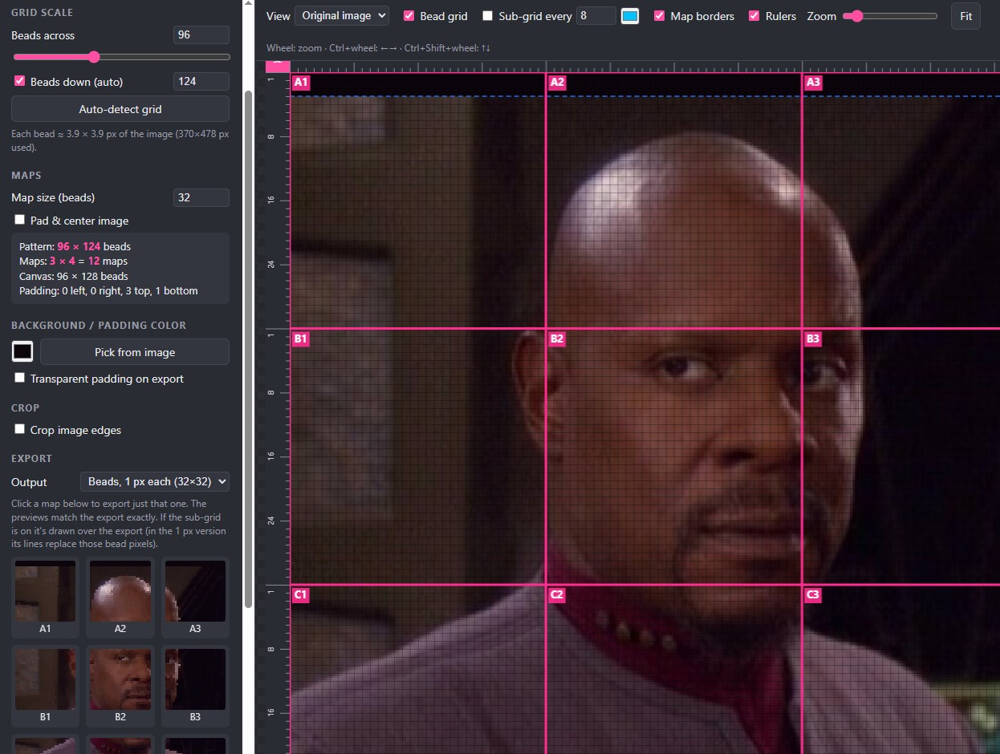

# Kandi2Artmap

A small Artmap/PERLER Assistant tool.

# To use

1. Double-left click `Kandi2Artmap.html` to open in your default browser (or click and drag to said browser)
2. Upload your file at the top left
3. Adjust settings as necessary
4. Enjoy!

# Left Column Help

## Grid Scale

This details how many "beads" across the original image is. Scaling this will scale the image according to the **Map Size**

## Maps

Map Size determines how many "chunks" you want the main gridlines to be in that cut it into sections. These are the sections that are exported.

## Background/Padding Color

If your image is not automatically "Square" to the **Map Size**, the tool will "pad" the extra room so it is equal. You can choose a color for preview and transparent for export.

## Cropping & Panning

Cropping can be done if you checkmark the **Advanced: Crop Image Edges** box and either resize the box or insert the desired crop px in the boxes. 

This will also bring up a rectangle for you with the original image so it is easier to crop.

## Export

You can export in a multiple of ways.
- Beads, at 1px each in maps of 32x32 (so 32x32 images)
- Enlargened Beads -> Defined by you!
- Original Image (Cropped)

You can optionally either Export All Maps via a one-click button (sends you a .zip) or you can click each preview to export one-by-one. Additionally, you may crop the image edges.

# Top Ribbon Help

## View

You're able to view the image in two ways--one way with the default image, one with all the pixels colored one color for you.

## Bead Grid & Sub-Grid

The Bead Grid is the default black grid. Defined by **Map Size**.

You can optionally have a SubGrid to help assist with pixel-perfect placement, in case you get "lost" counting. You checkmark the box, input the number you want the grid to appear at, pick the color, and it'll appear for you. **This shows in export.**

## Map Borders & Rulers

Map Borders are the pink grid lines defined by **Map Size**. Rulers are just the numerical placemarkers on the external surface of the canvas of the image.

# Canvas Help

## Zoom & Pan

You can zoom with Scroll Wheel.

Panning can be done with either Middle Scrollwheel, Ctrl+Scrollwheel to go left and right, or Ctrl+Shift+Scrollwheel to go up and down.

## Transposition and Resizing

You can resize and move your image on the background if you chose to on the canvas by grabbing the blue edges covering the dashed black line surrounding your image. 